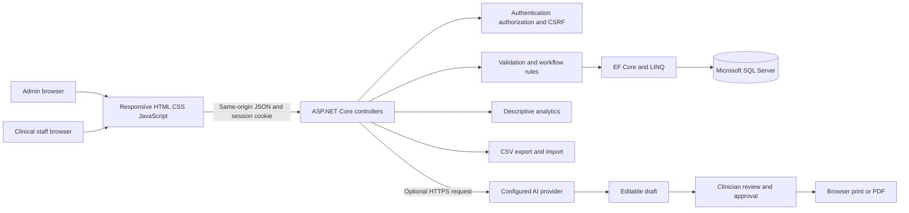
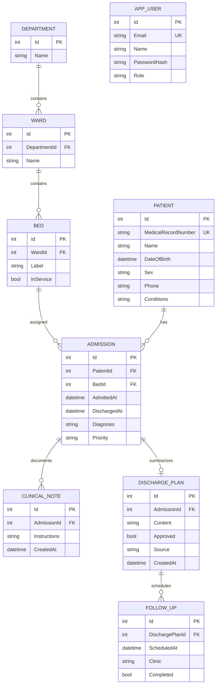
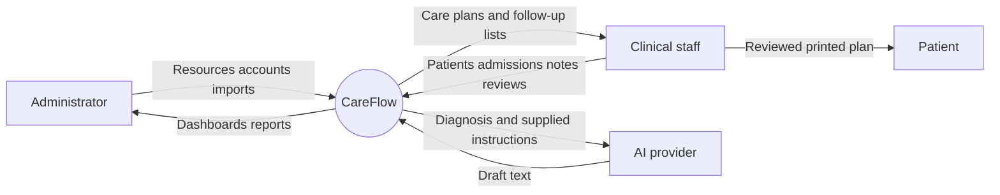
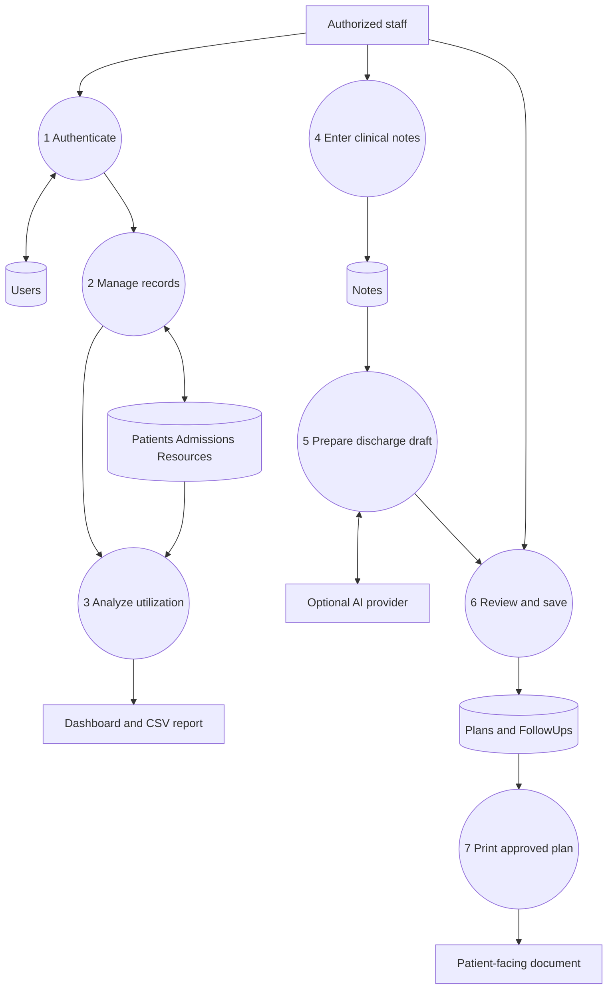

# CareFlow: Hospital Resource & Patient Readmission Analytics

## Abstract
CareFlow is a web-based hospital operations prototype that connects patient admissions, bed allocation, discharge planning, and readmission analysis. Hospitals need a coherent view of patient arrivals and available resources while supporting continuity of care after discharge. The application combines an ASP.NET Core Web API, Entity Framework Core, Microsoft SQL Server, and a responsive JavaScript frontend. It reports current occupancy, admission volume, average completed length of stay, and observed 30-day readmissions. A discharge studio converts clinician-entered instructions into editable patient-facing drafts using either a deterministic template or a configured generative-AI provider. Human review remains required before a plan is shared. Synthetic data and automated tests support reproducible academic evaluation.

## Problem statement
Unpredictable patient influx can make bed allocation difficult. Disconnected records make it harder to determine which beds are occupied, identify repeated admissions, and coordinate follow-up. Patients may also leave with instructions that are difficult to understand. CareFlow addresses the information-management portion of these challenges by combining operational records, descriptive analytics, and a consistent discharge workflow. It does not claim to solve clinical causation or prove improved hospital outcomes.

## Objectives
1. Ingest and maintain patient and admission records through validated CRUD and CSV import.
2. Represent departments, wards, beds, and their relationships without losing historical admissions.
3. Show real-time resource utilization and trends derived from stored records.
4. Identify observed readmissions using an explicit 30-day definition and mature observation cohort.
5. Draft plain-language discharge instructions from clinician-provided information.
6. Support Admin and User roles, secure sessions, and server-side authorization.
7. Produce portable reports and an evaluation-ready implementation with repeatable tests.

## Expected outcomes
A connected dashboard, reduced manual work in bed lookup and report generation, traceable patient journeys, and editable discharge drafts. These are functional outcomes. Any real reduction in overcrowding or readmissions requires a prospective deployment study with clinical oversight.

## Technology and methodology
- Backend: C# / ASP.NET Core 10, controller-based REST API, dependency injection.
- Persistence: Microsoft SQL Server and EF Core 10; LINQ for queries and descriptive aggregation. SQLite is a clearly separated local-development fallback.
- Frontend: semantic HTML, custom responsive CSS, vanilla JavaScript and SVG charts. No frontend framework is required by the brief.
- Security: ASP.NET Core cookie authentication, password hashing, antiforgery tokens, role authorization, login rate limiter.
- Reports: UTF-8 CSV with spreadsheet-formula escaping, print-to-PDF from approved plans.
- AI: server-side HTTP call to a configurable HTTPS chat-completions provider; API secrets stay on the server.
- Delivery: Git source history, Docker/Compose, GitHub Actions, Swagger, Postman, Python HTTP tests and Playwright browser checks.

The implementation follows iterative delivery: requirements → schema and invariants → security/API → UI → analytics and drafting → integration checks → documentation. Synthetic records avoid relying on patient data during development. Tests target observable workflows and authorization boundaries rather than merely repeating implementation logic.

## System architecture

The frontend is served by the same ASP.NET Core process as the API. This simplifies session handling and avoids cross-origin authentication configuration. Static assets contain no database or provider secrets. The production SQL database is external to the application container. A development-only SQLite provider allows the same API and UI to run without a database service.

## Actors and authorization
| Capability | Admin | User / clinical staff |
|---|---|---|
| Overview and resource lookup | Yes | Yes |
| Patient/admission CRUD | Yes | Yes |
| Notes, plans, follow-ups | Yes | Yes |
| Department/ward/bed mutations | Yes | No |
| Bulk patient import | Yes | No |
| Admission CSV export | Yes | No |
| Create team accounts | Yes | No |

User is a staff role. A patient self-service portal, organization tenancy, per-patient assignment restrictions, password reset, and MFA are outside the implemented scope.

## ER diagram

AppUser is the ninth security table; the eight domain tables form the related clinical-resource model. There is no invented user-to-note authorship relationship in the current schema. Clinical authorship audit history is a future extension.

## Data dictionary and integrity
| Table | Purpose and constraints |
|---|---|
| Departments | Unique name; referenced by wards |
| Wards | Required department; referenced by beds |
| Beds | Unique label; in-service flag; referenced by admissions |
| Patients | Unique medical record number; validated demographics |
| Admissions | Required patient/bed; valid dates; priority enumeration |
| ClinicalNotes | Required admission and clinician instructions |
| DischargePlans | At most one plan per admission; editable content, source, approval flag |
| FollowUps | Required plan, appointment time, clinic and completion flag |
| Users | Unique email; hashed password; Admin/User role |

Foreign keys use restrictive deletion. A patient with admissions cannot be silently deleted; related records must be handled explicitly. Filtered unique indexes on Admission.BedId and Admission.PatientId where DischargedAt is null protect concurrent active assignments. API overlap checks reject conflicting historical or active intervals. A currently occupied bed cannot be marked out of service. Initial schema is generated from the same EF model as the running application.

## DFD — context level

## DFD — level 1

## Workflows
### Admission and allocation
Search or create a patient → choose an in-service available bed → enter admission time, reason and priority → validate patient and bed relationships and interval → persist → dashboard reflects occupancy. Discharge sets DischargedAt and releases the active assignment. Completed stays remain in history.

### Discharge studio
Select an admission → review/add clinical instructions → choose template or AI → generate editable draft → review every statement → edit if needed → explicitly approve → save → print/save PDF. Editing the draft clears the frontend approval checkbox. Generated drafts do not automatically become approved plans. Follow-ups are recorded against the saved plan.

### Import and export
Import a CSV using the supplied five-column template. Parse up to 500 rows, validate every row and record number, and persist the batch only if it is valid. Embedded commas/quoted fields are intentionally unsupported and reported. Export admission history as CSV with proper quoting and formula-prefix escaping.

## Analytics definitions
- **Current occupancy:** active admissions / beds currently in service × 100. A missing denominator displays zero percent, with counts visible.
- **Admissions:** admissions whose start occurs within the selected 7/30/90-day calendar window.
- **Daily flow:** admission count and occupied-bed count at the end of each UTC day. Today's count reflects currently known data. Historical capacity changes are not stored, so the chart shows counts, not a historical occupancy percentage.
- **Average length of stay:** average elapsed days among admissions discharged in the selected window.
- **Readmission:** an eligible discharge with at least one subsequent admission for the same patient from discharge time through 30 days later. Each discharge contributes at most one positive case. The denominator includes discharges in a window of the selected duration ending 30 days before now. This avoids calling unobserved recent discharges negative outcomes. If no eligible discharges exist, show no rate.

This prototype does not distinguish planned readmissions or transfers and does not adjust for case mix. The Reports screen compares eligible discharges, readmissions, rates, and average stay by reason for admission. This supports descriptive factor exploration, but causal risk-factor modeling is not claimed.

## Input validation and error handling
Required and maximum-length field annotations, enum restrictions, valid birth-date ranges, date ordering, foreign-key existence, active-bed checks, CSV-size limits, uniqueness constraints, and relationship restrictions protect data integrity. Expected validation errors return 400; missing records 404; relationship/uniqueness conflicts 409; unauthorized/forbidden 401/403; unconfigured AI 503; provider failures 502. Unexpected failures use generic Problem Details without exposing credentials. The UI shows errors within forms or an accessible status notification.

## Security design
Passwords use ASP.NET Core's password hasher. Cookies are HttpOnly and SameSite Strict, Secure in production, and time-limited. Every mutating API request requires a session-bound antiforgery token; obtain a new token after sign-in. Resource administration, account creation, imports and report exports require Admin. Login is rate-limited per remote address. API responses are marked no-store. Browser security headers prevent framing and restrict script/resource origins. Demo users are seeded only in Development. Production bootstrap requires explicit credentials.

## Advanced features
1. Optional GenAI discharge drafting with clinician review and transparent template fallback.
2. Validated CSV file upload/import with all-or-nothing save behavior.
3. Excel-compatible CSV reporting and browser print-to-PDF for approved patient plans.

## Results and evidence
See `VERIFICATION.md` for the final executed checks and environment-specific limits. Dashboard and mobile screenshots are in `screenshots/`. Local tests verify functional workflows rather than hospital outcome improvements. The evaluation uses 24 synthetic patients, 48 beds across four wards, historical admissions and active admissions. Counts can change as demonstration records are edited.

## Limitations and future work
- Real deployment requires institution-specific access control, retention, clinical validation, monitoring, backups, disaster recovery, consent and provider data-processing arrangements.
- No immutable clinical audit trail, per-record optimistic versioning, password-reset workflow or MFA is implemented.
- Initial schema creation uses EnsureCreated, not versioned EF migrations; introduce migrations before evolving a persistent production database.
- Active allocation uniqueness is enforced in the database; historical overlap checks need stronger transaction/concurrency handling for large multi-user production workloads.
- Queries load bounded demonstration datasets into memory; production scale needs database-side aggregation, paging, and index tuning.
- AI output may be incorrect despite prompt constraints and must be reviewed. Live-provider performance is not established without configured credentials.
- No clinically validated predictive model, automatic treatment decisions, or email delivery is included.

## Conclusion
CareFlow implements a connected hospital-resource and patient-care workflow using the required .NET and relational technologies. Its main contribution is a clear, responsive interface backed by real persisted data, explicit analytics definitions, role-based APIs, and an editable discharge-planning process. The prototype supplies a reproducible foundation for evaluation; clinical outcomes and production readiness require subsequent validation.

## Primary technical references
- [ASP.NET Core cookie authentication](https://learn.microsoft.com/en-us/aspnet/core/security/authentication/cookie?view=aspnetcore-10.0)
- [ASP.NET Core antiforgery](https://learn.microsoft.com/en-us/aspnet/core/security/anti-request-forgery?view=aspnetcore-10.0)
- [EF Core indexes](https://learn.microsoft.com/en-us/ef/core/modeling/indexes)
